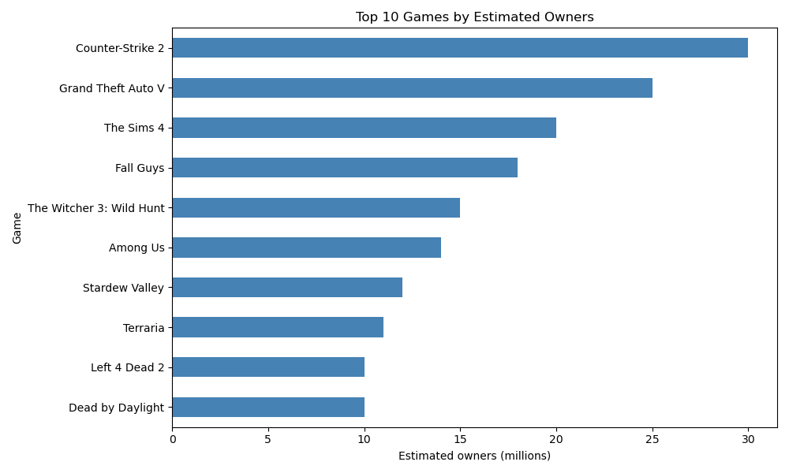
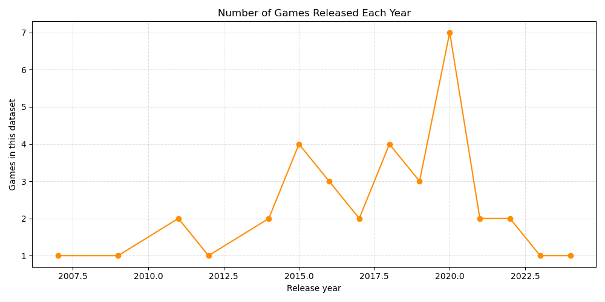
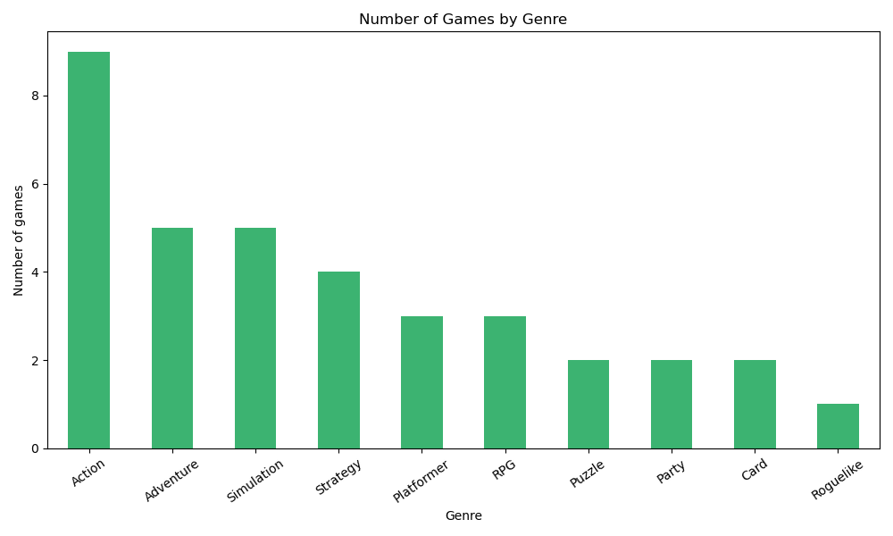
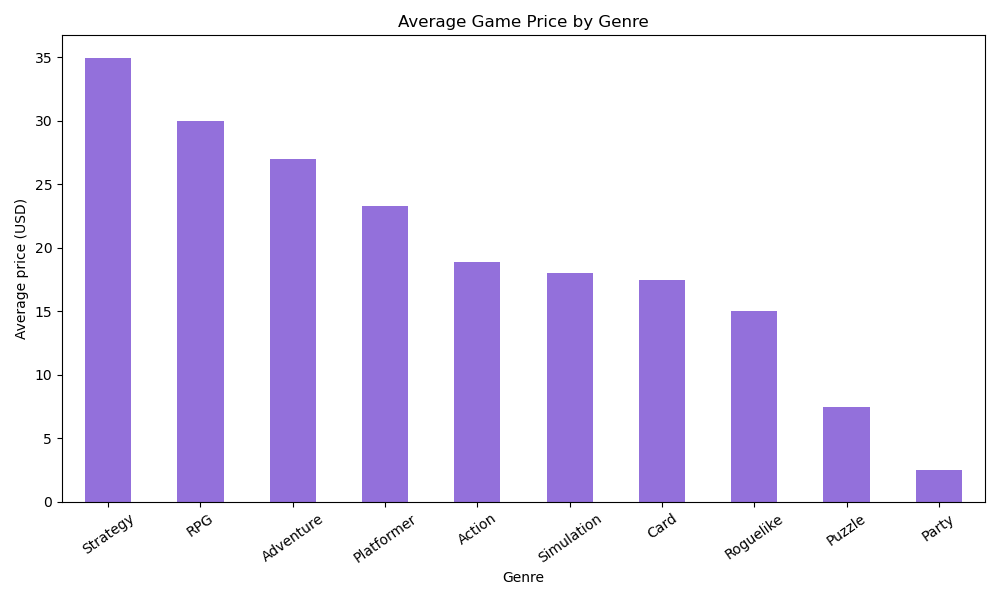
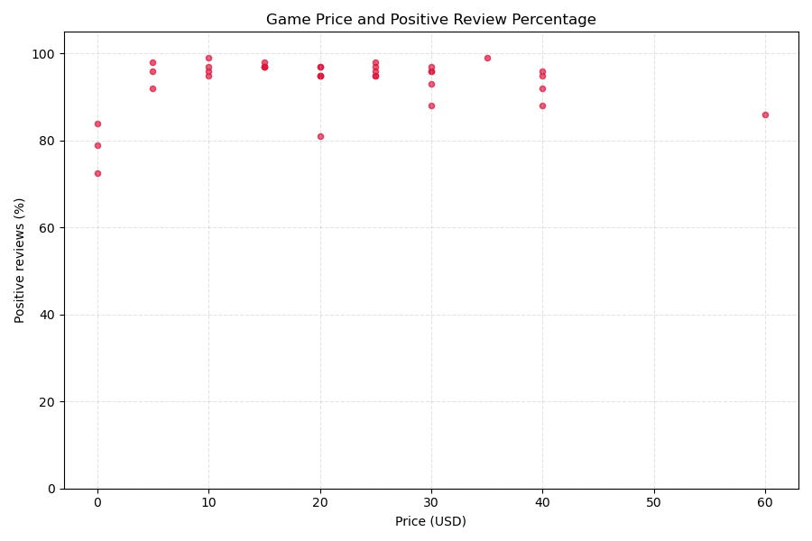
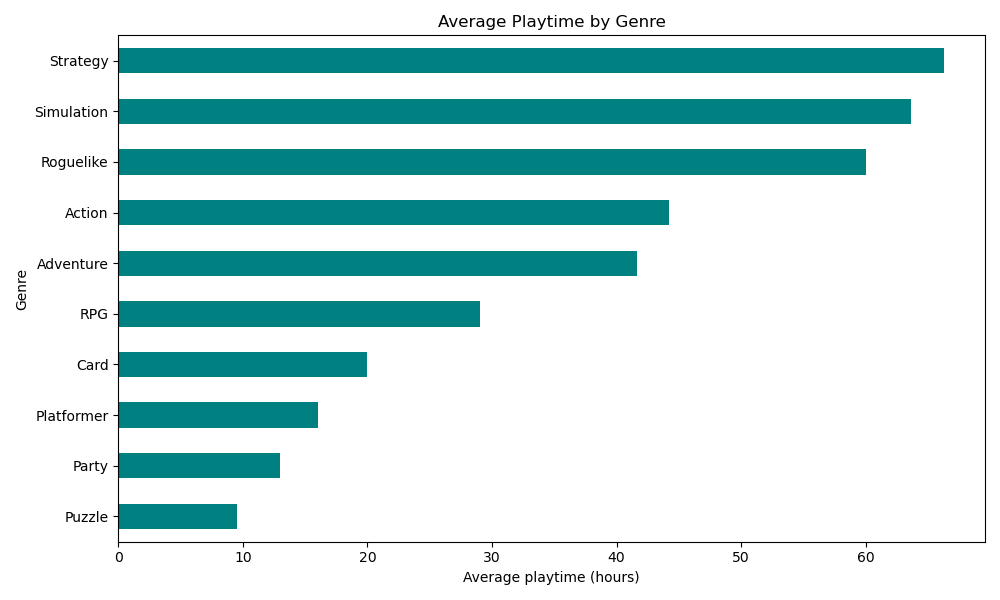
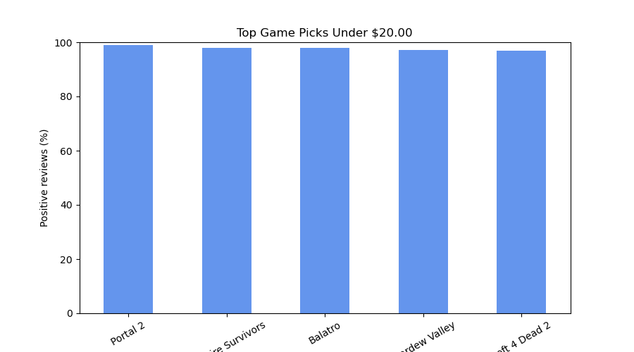

<h1 align="center">🎮 Steam Game Store Data Analysis</h1>

<p align="center">
  <strong>A beginner-friendly Class 12 Informatics Practices project</strong><br>
  Explore sample game data with Python, Pandas, and Matplotlib.
</p>

<p align="center">
  
  
  
  
</p>

---

## ✨ What you can explore

- Browse game records and search for a game by name.
- Compare genres, prices, release years, reviews, and estimated playtime.
- Open each graph separately from a simple numbered menu.
- Find top-rated games that fit a budget and optional genre.
- Save charts as PNG images, or view them in IDLE when a graphical window is available.

## 📊 Chart gallery

The graph menu offers six individual analyses. The budget finder creates a seventh comparison chart when you use it.

| 🏆 Top games by estimated owners | 📅 Games released each year |
|:--:|:--:|
|  |  |

| 🎭 Games by genre | 💵 Average price by genre |
|:--:|:--:|
|  |  |

| ⭐ Price and positive reviews | ⏱️ Average playtime by genre |
|:--:|:--:|
|  |  |

### 🎯 Budget game finder

Choose a maximum price and optionally a genre. The program lists up to five top-rated matches and creates this comparison chart.



## 🚀 Run the project

1. Install [Python 3](https://www.python.org/downloads/).
2. Download or clone this repository and open a terminal in the project folder.
3. Install the libraries and start the menu:

**Windows**

```bash
python -m pip install -r requirements.txt
python analyse_steam.py
```

**macOS or Linux**

```bash
python3 -m pip install -r requirements.txt
python3 analyse_steam.py
```

### Run it in IDLE

Open `analyse_steam.py` in IDLE and press **F5** (or choose **Run → Run Module**). Enter menu choices in the IDLE Shell. For the budget finder, enter a price and a genre, or type `all`.

## 🕹️ Main menu

| Choice | What it does |
|:--:|---|
| 1 | Project introduction |
| 2 | Dataset information |
| 3 | Show the first ten games |
| 4 | Show the top games by estimated owners |
| 5 | Create a genre report |
| 6 | Show the highest positive-review percentages |
| 7 | Search for a game |
| 8 | Choose one graph, or generate all six analysis graphs |
| 9 | Find games within a budget and create a comparison chart |
| 0 | Exit |

## 🧠 Class 12 IP concepts

- Read CSV data into a Pandas DataFrame.
- Select columns, handle missing values, group records, and calculate averages.
- Create bar, horizontal bar, line, and scatter graphs with Pandas `.plot()` and Matplotlib.
- Use a menu and functions to organise a small data-analysis program.

## 📁 Project files

```text
steam_game_analysis/
├── analyse_steam.py          # Numbered menu and analysis functions
├── data/
│   └── steam_games.csv       # Small example dataset
├── outputs/graphs/           # Saved chart images
├── requirements.txt          # Pandas and Matplotlib
└── README.md
```

## 🧾 CSV columns

| Column | Meaning |
|---|---|
| `game_name` | Game title |
| `genre` | Main genre |
| `release_year` | Release year |
| `price_usd` | Price in US dollars (`0` means free) |
| `positive_reviews` | Positive reviews in the sample |
| `negative_reviews` | Negative reviews in the sample |
| `average_playtime_hours` | Average playtime in hours |
| `estimated_owners_millions` | Estimated owners, in millions |

> **About the data:** `data/steam_games.csv` is an illustrative sample for learning. Its review totals, owner estimates, prices, and playtimes are not verified official Steam statistics. Replace it with a reliable dataset if your assignment requires real-world figures.

---

<p align="center"><sub>Made for learning CSV analysis, Pandas, and Matplotlib in Class 12 IP.</sub></p>
